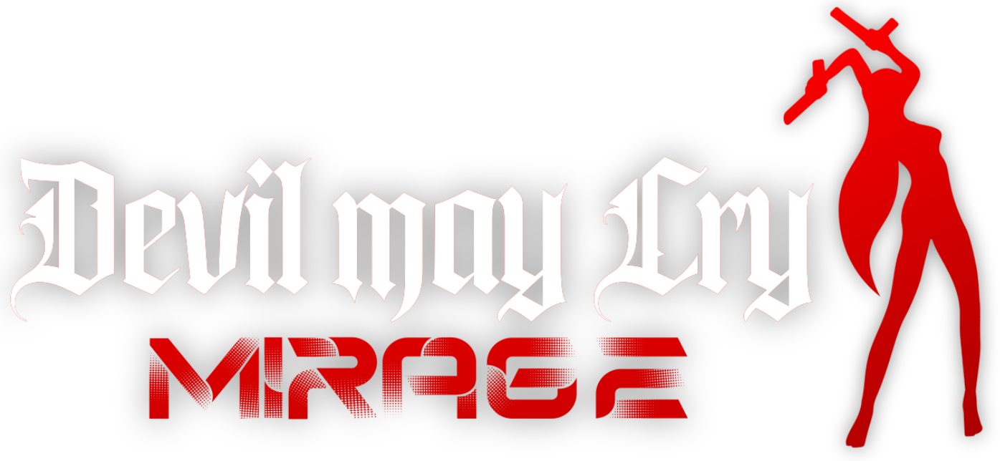

<p align="center">
   
</p>

# DMC1 Mirage

A comprehensive modern enhancement mod for Devil May Cry 1 in the HD Collection, featuring on-the-fly style switching, weapon switching, the custom Mirage Title Launcher, the infinite training arena (**The Void**), and mission select.

A short press of a trigger changes weapons. Holding the trigger keeps the original action: the left trigger still activates Devil Trigger, and the right trigger still shoots.

The mod loads only with `dmc1.exe`, through the `XINPUT9_1_0.dll` the game already imports. It does not edit `dmc1.exe`, `dinput8.dll`, `Crimson.dll`, or `d3d11.dll`.

## Mirage Title Launcher

Mirage replaces the title menu with a custom high-resolution launcher featuring high-DPI gothic typography, dynamic lighting, and direct access to game modes:
- **Load Data**: Quickly load your existing save game.
- **Mission Select**: Select and launch any of the 23 missions across any difficulty (Easy, Normal, Hard, Dante Must Die).
- **The Void**: Jump directly into the infinite practice arena.
- **Boss Rush**: Rapid-fire boss gauntlet challenge.
- **Settings**: In-game configuration and audio/visual options.

## Install

Close the game, then run `ApplyDMC1Mirage.exe` from the release. It finds the Steam copy of Devil May Cry 1 and places the mod beside `dmc1.exe`. If Steam is installed somewhere unusual, choose `dmc1.exe` when asked.

Launch Devil May Cry 1 from Steam after that.

## Play

From the title screen, the **Mirage Launcher** provides immediate access to your save files, mission select, and training arena.

During combat:
- **Left Trigger (LT / L2)**: Tap to cycle melee weapons (Alastor, Ifrit, Force Edge, Sparda). Hold to activate Devil Trigger.
- **Right Trigger (RT / R2)**: Tap to cycle firearms (Handguns, Shotgun, Grenade Gun, Nightmare-β). Hold to shoot.

The tap window defaults to 180 ms and can be changed in `dmc1-mirage.ini` (or `dmc1-switch.ini`) next to the game:

```ini
[switch]
tap_ms=180
trigger_threshold=30
```

Reset on the pause menu returns to the title screen.

## Styles

Switch styles during gameplay using the D-Pad or keyboard keys **Z, X, C, V**:
- **D-Pad Up** / **Z**: **Trickster**
- **D-Pad Right** / **X**: **Swordmaster** *(coming soon)*
- **D-Pad Left** / **C**: **Gunslinger** *(coming soon)*
- **D-Pad Down** / **V**: **Royal Guard** *(coming soon)*

### Trickster Actions (B / Circle Button or L Key)
- **Ground Dash**: Tap **B** or **L** to dash forward or in the direction of movement with invulnerability frames (i-frames).
- **Sky Star (Air Dash)**: Tap **B** or **L** mid-air to dash horizontally and reset vertical fall.
- **Air Trick (Forward Warp)**: Hold **Lock-On (RB / Space)** + **Forward (W)** + **B / L** to instantly warp forward directly into attack range.
- **Trick Down (Retreat Warp)**: Hold **Lock-On (RB / Space)** + **Back (S)** + **B / L** to warp backward and escape enemy attacks.

## The Void (Training Arena)

Select **The Void** directly from the Mirage Launcher to enter the infinite practice room.

### Arena Controls & Settings
- **Insert Key**: Toggle the floating practice configuration menu.
- **Monochrome High-Transparency Menu**: Sleek black-and-white glass interface with atomic mouse click registration.
- **Enemy Dummies**: Spawn training dummies (Marionette, Sin Scissors, Plasma, Shadow, Frost, Nobody, Fetish, Blade) with customizable AI states:
  - **Stand Still**: Immobile dummy for combo routing and juggle testing.
  - **Guard**: Constant defense for hit-reaction checks.
  - **Attack**: Hostile AI for counter-timing rehearsal.
  - **Evade**: Evasive maneuvers for chase down tracking.
- **Dummy Count**: Dynamically scale between 1 and 4 dummies with automatic circular formation spacing.
- **Real-Time Telemetry HUD**: Live combo counter, total damage, juggle height tracking, and air-time measurement.
- **Reset Formation**: Tap **Reset Position** or press **Home** to instantly teleport dummies 300 units in front of Dante with zeroed velocity and refreshed health.

## Build

The proxy is built with g++ from the `dmc1-mirage` directory:

```powershell
g++ -shared -O2 -std=c++17 -static -static-libgcc -static-libstdc++ -I src -I src/dante -I src/trish -I src/lady -I src/power -I src/jackpot -o build\XINPUT9_1_0.dll src\jackpot\xinput_proxy.cpp src\power\mod.cpp src\jackpot\ui.cpp src\dante\style.cpp src\dante\style_trickster.cpp src\dante\style_hud.cpp src\lady\the_void.cpp src\lady\the_void_menu.cpp src\trish\coordinates.cpp xinput.def -ld3d11 -ldxgi -ld3dcompiler -lgdiplus -lgdi32 -lole32 -luuid -luser32
```

`tools/build_installer.py` then packs that DLL into `ApplyDMC1Mirage.exe`.

This project is not affiliated with Capcom.
